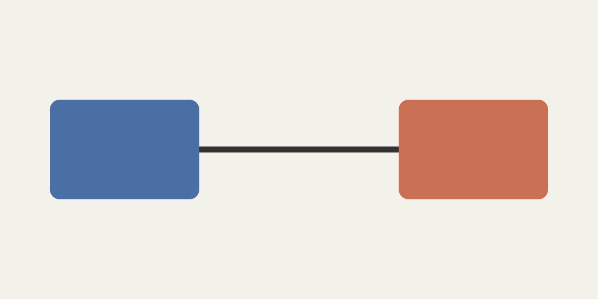

# Writing with sinter-markdown

A paragraph with *emphasis*, **strong text**, ~~strikethrough~~, `inline code` and a [link](https://example.com "Example").
A hard break follows\
and an autolink: www.example.com. Entities decode: Fish &amp; chips &copy;.

## Lists

- one
- two, with a [reference link][ref]
  - nested

1. first
2. second

3. third, after a blank line: the list is loose

- [x] a task that is done
- [ ] a task that is not

## Code

```js title="hello.js"
console.log('hello');
```

> A quote, with a paragraph.
>
> ### A heading inside it

## Lists

The same heading text twice gets a second anchor.

| Name | Count |
| :--- | ----: |
| apples | 3 |
| pears | `12` |

---



<kbd>Ctrl</kbd> and <script>alert(1)</script> are shown as written by default.

[ref]: ./other.md
